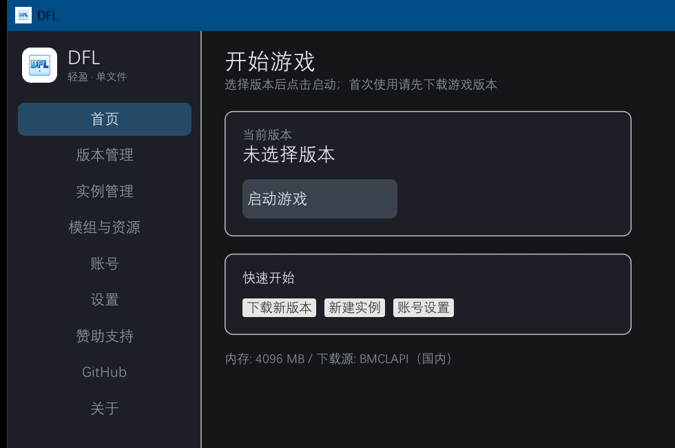
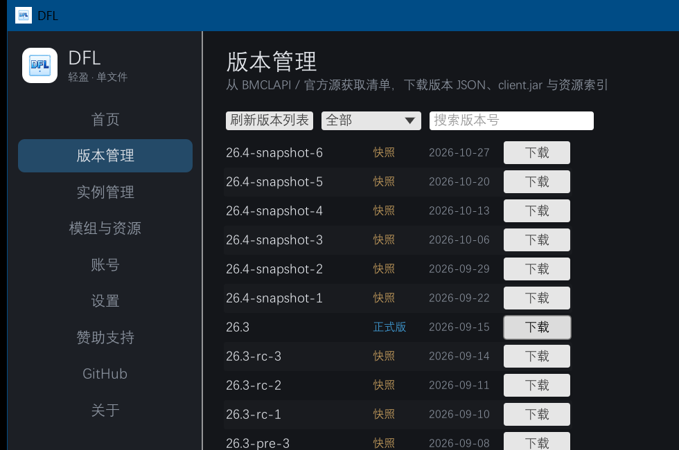
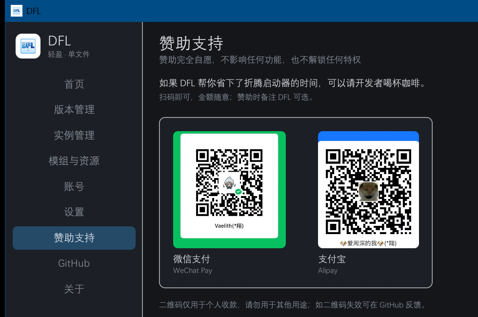
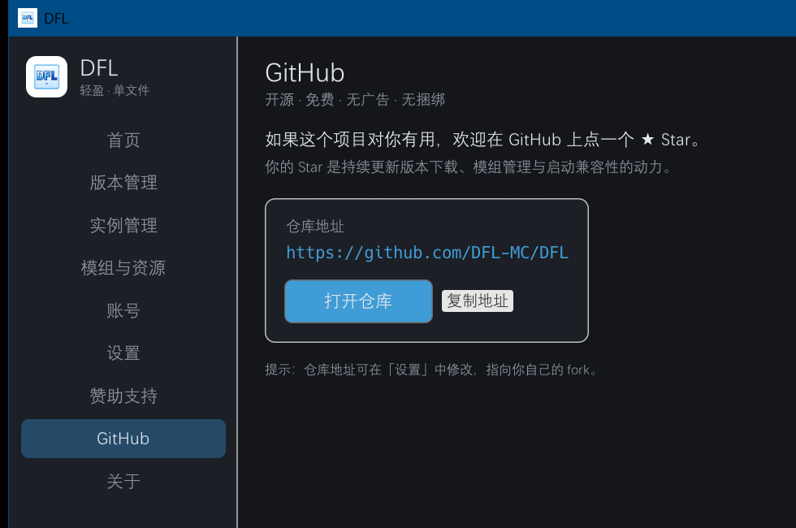

# DFL

[](https://github.com/5y2znfz2df-del/DFL/actions/workflows/build.yml)

轻量级 Minecraft Java 版启动器（Windows / Rust + egui / 单 exe）。



## 特性（开发中）

- 单文件可执行，无 .NET / Electron / WebView 运行时依赖
- 国内镜像（BMCLAPI）与官方源切换
- 版本下载与管理、实例隔离、模组/资源包/光影管理
- Java 自动探测与下载、内存与 JVM 参数设置
- 离线登录 + 微软正版登录 + 外置登录
- 日志查看
- 赞助支持（微信 / 支付宝）与 GitHub Star 页面

## 进度

| 模块 | 状态 |
|---|---|
| 界面骨架 / 配置 / 字体 / 图标 | ✅ |
| 版本清单（BMCLAPI + 官方回退） | ✅ |
| 版本下载：version JSON / client.jar / 资源索引（SHA1 + 进度） | ✅ |
| 游戏启动（classpath / natives / JVM 参数） | ⏳ |
| 账号（离线 / 微软 / 外置） | ⏳ |
| Java 探测与下载 | ⏳ |
| 模组 / 资源包 / 光影 | ⏳ |



## 构建

```powershell
# 需要 Rust 1.75+ 与 MSVC 链接器
cargo build --release
# 产物: target/release/dfl.exe
```

## 运行

```powershell
cargo run --release
```

数据目录优先使用 exe 同级的 `data/`（绿色便携），不可写时回退到 `%APPDATA%\DFL`。

## 目录

- `src/app.rs` 界面与页面路由（首页/版本/实例/资源/账号/设置/赞助/GitHub/关于）
- `src/config.rs` 配置持久化
- `src/util.rs` 路径工具、图标与浏览器打开
- `assets/` 图标与收款二维码
- `docs/ARCHITECTURE.md` 架构与底层原理

## 说明

仅用于个人学习，不内置任何账号、密钥或 API Key。
项目仓库：<https://github.com/5y2znfz2df-del/DFL>（可在「设置」中改成你自己的 fork 地址）。

| 赞助支持 | GitHub |
|---|---|
|  |  |
